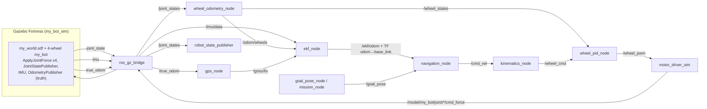

# Architecture



## Packages (one per stage)

| Package | Stage | Contents |
|---|---|---|
| `ugv_core` | all | ROS-free algorithms (`ekf`, `kinematics`, `odometry`, `navigator`, `pid`, `wheel_control`, `geo`, `metrics`), `config/robot.yaml`, unit tests |
| `my_bot_sim` | sim | world, four-wheel SDF model, URDF (TF), bridge launch, `motor_driver_sim.py` |
| `ugv_sensors` | 1 | `wheel_odometry_node` (encoder ticks → odometry), `gps_node` (noise + dropout) |
| `ugv_nav` | 2, 3 | `ekf_node`, `navigation_node`, `goal_pose_node`, evaluation nodes `ekf_eval_node`, `mission_node` |
| `ugv_control` | 4, 5 | `kinematics_node`, `wheel_pid_node`, tools `pid_step_test`, `slip_calibration` |
| `ugv_bringup` | 6 | `full_system`, `eval_ekf`, `eval_navigation` launch files |

Launch files nest, so each stage can be run on its own:
`sim.launch.py` ⊂ `sensors.launch.py` ⊂ `control.launch.py` ⊂ `full_system.launch.py` (+ `nav_stack.launch.py`).

## Nodes and rates

| Node | Rate | In | Out |
|---|---|---|---|
| Gazebo | physics 1 kHz, IMU 100 Hz, truth 50 Hz | `cmd_force` x4 | joint states, IMU, truth |
| `wheel_odometry_node` | 100 Hz / 50 Hz | `/joint_states` | `/wheel_states`, `/odom/wheels` |
| `gps_node` | 5 Hz | `/true_odom`, `/gnss/enable` | `/gnss/fix` |
| `ekf_node` | updates on arrival, publishes 50 Hz | `/odom/wheels`, `/imu/data`, `/gnss/fix` | `/ekf/odom`, TF |
| `navigation_node` | 20 Hz | `/ekf/odom`, `/goal_pose` | `/cmd_vel`, `/nav/state`, `/nav/goal_reached` |
| `kinematics_node` | 50 Hz | `/cmd_vel` | `/wheel_cmd` (FL, RL, FR, RR rad/s) |
| `wheel_pid_node` | 100 Hz | `/wheel_cmd`, `/wheel_states` | `/wheel_pwm` (duty), `/wheel_pid/state` |
| `motor_driver_sim` | 200 Hz | `/wheel_pwm` | `/model/my_bot/joint/<wheel>_wheel_joint/cmd_force` |
| `robot_state_publisher` | on joint states | `/joint_states` | TF base_link → chassis, imu, gnss, wheels |

All nodes run on simulation time (`/clock` is bridged, `use_sim_time: true`).

## TF tree

```
odom ──(ekf_node)──► base_link ─┬─► chassis_link
                                ├─► imu_link
                                ├─► gnss_link
                                └─► front_left_wheel, rear_left_wheel, front_right_wheel, rear_right_wheel
```

`ekf_node` is the **only** publisher of `odom → base_link`. Gazebo publishes no TF, since there
is no DiffDrive plugin. `base_link` is on the ground under the chassis centre.

## Frames and the GPS datum

- World: `+X` east, `+Y` north (ENU), `heading_deg = 0`, datum 22.62° N 75.69° E.
- The robot spawns at the world origin with yaw 0. `odom` therefore coincides with the
  Gazebo world, and `/ekf/odom` and `/true_odom` can be compared directly.
- `gps_node` and `ekf_node` both use the datum from their parameters. Keep these equal to
  `<spherical_coordinates>` in `my_world.sdf`.

## Why these design choices

- **No DiffDrive plugin.** Stages 4 and 5 must be ours, so Gazebo only receives per-wheel
  torques. The DC-motor back-EMF is the joint damping, so the physics engine applies it at
  1 kHz; the ROS side only commands `τ_s·duty`.
- **PWM duty as the controller output.** This is the same interface a motor driver takes,
  so the optional hardware extension (see `hardware.md`) replaces only `motor_driver_sim`.
- **GPS synthesised from ground truth.** Noise, rate and dropout are explicit and
  reproducible (`sensors.yaml`, `/gnss/enable`).
- **Algorithms in `ugv_core`.** The ROS nodes are thin wrappers, which makes the algorithms
  unit-testable without ROS.
